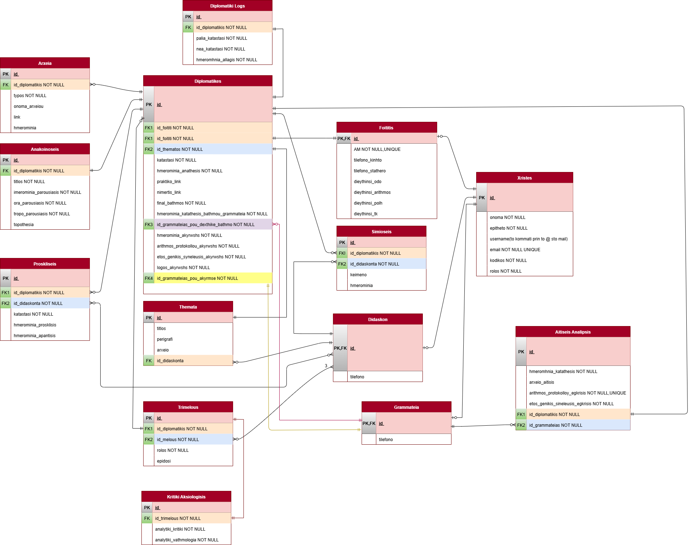

# Web Uni Project 2025 — University Thesis Management System

A full-stack web application for managing the complete lifecycle of undergraduate theses—from topic proposal and three-member examination committee formation to defense announcements, grading, and final completion. Built with **Node.js**, **Express**, and **MySQL** on the backend, paired with a dynamic **HTML/CSS/JavaScript** frontend.

## Application Architecture & Features

### Entry Shell & Public Portal (`index.html`, `header.html`)
* **Dynamic Single-Page Navigation:** Loads a shared navigation bar (`header.html`) and dynamically renders role-specific dashboards into the main container based on authenticated `localStorage` session state (`foititis`, `didaskon`, or `grammateia`).
* **Public Presentation Schedule:** Allows visitors to filter upcoming thesis defense announcements by start and end date and download the results directly as formatted **JSON** or **XML** files.

### Role-Based Dashboards
* **Student Dashboard (`foititis.html`):**
  * **Thesis Overview:** Displays assigned topic details, downloadable PDF description, assignment date, dynamically calculated elapsed implementation time, and current examination committee members.
  * **Committee Formation & Completion:** Provides live autocomplete instructor search to send committee invitations during the `ypo_anathesi` phase, and displays final grades, evaluation reports (`praktiko_link`), and Nemertes (Νημερτής) repository link submission once evaluated.
  * **Deliverables & Defense Scheduling:** Unlocks draft/supporting file uploads, external links, and defense presentation scheduling (in-person `di_zosis` or `online`) once a thesis enters the `ypo_exetasi` stage.
  * **Profile Management:** Lets students update contact numbers, registration number (`AM`), and residential address details.
* **Instructor Dashboard (`didaskon.html`):**
  * **Topic Management:** Create, edit, and delete thesis topics with optional PDF attachments.
  * **Topic Assignment:** Live autocomplete student search (by name or `AM`) to assign available topics (`ypo_anathesi`).
  * **Committee Invitations:** Review pending invitations and accept (`apodexti`) or reject (`aporrifthi`) participation—automatically activating the thesis (`energi`) once two committee members accept.
  * **Supervised & Committee Theses:** Expandable thesis cards displaying student info, committee members, elapsed duration, final grades, and one-click **CSV** (UTF-8 BOM) and **JSON** list exports.
* **Secretariat Dashboard (`grammateia.html`):**
  * **Bulk User Registration:** Parses uploaded `.json` user arrays client-side and bulk-inserts students, instructors, and secretariat staff with `bcrypt`-hashed passwords.
  * **Thesis Administration:** Expandable overview of active and under-examination theses alongside forms to record General Assembly approval protocol numbers, cancel assignments with protocol/reason metadata, and finalize completed theses (`peratomeni`).

## Database Schema (`diplomatikes_db`)

The relational MySQL schema consists of **14 tables** normalized across user roles, thesis workflows, committee evaluations, and audit logs[cite: 1]:

### Users & Role Extensions
* **`xristes`** — Core user accounts (`id`, `onoma`, `epitheto`, `email`, `password` hashed with `bcrypt`, `rolos` ENUM: `foititis` | `didaskon` | `grammateia`, and a stored generated `username` derived from `email`).
* **`foititis`** — Student profile extension (`id`, `AM`, `tilefono_kinhto`, `tilefono_stathero`, `dieythinsi_odo`, `dieythinsi_arithmos`, `dieythinsi_polh`, `dieythinsi_tk`).
* **`didaskon`** — Instructor profile extension (`id`, `tilefono`).
* **`grammateia`** — Secretariat staff profile extension (`id`, `tilefono`).

### Thesis Lifecycle & Administration
* **`themata`** — Thesis topics proposed by instructors (`id`, `titlos`, `perigrafi`, `arxeio`, `id_didaskonta`).
* **`diplomatikes`** — Central thesis tracking table (`id`, `id_thematos`, `id_foititi`, `katastasi` ENUM: `ypo_anathesi` | `energi` | `ypo_exetasi` | `peratomeni` | `akyromeni`, `hmerominia_anathesis`, `praktiko_link`, `nimertis_link`, `final_bathmos`, approval protocol metadata, and cancellation records).
* **`aitiseis_analipsis`** — Formal thesis assignment applications filed with the secretariat (`id`, `id_diplomatikis`, `hmerominia_katathesis`, `id_grammateias`, `arxeio_aitisis`, `arithmos_protokollou_egkrisis`, `etos_genikis_syneleusis_egkrisis`).
* **`diplomatiki_logs`** — Chronological audit log recording thesis state transitions (`id`, `id_diplomatikis`, `palia_katastasi`, `nea_katastasi`, `hmerominia_allagis`).

### Examination Committee, Evaluation & Deliverables
* **`trimeloys`** — Three-member examination committees (`id`, `id_diplomatikis`, `id_melous`, `rolos` ENUM: `epivlepontas` | `melos`, `epidosi`).
* **`proskliseis`** — Committee invitations sent to instructors (`id`, `id_diplomatikis`, `id_didaskonta`, `katastasi` ENUM: `ekremis` | `apodexti` | `aporrifthi`, `hmerominia_prosklisis`, `hmerominia_apantisis`).
* **`kritiki_aksiologisis`** — Individual committee member grades and qualitative feedback (`id`, `id_trimelous`, `analytiki_kritiki`, `analytiki_vathmologia`).
* **`simioseis`** — Private supervisor/committee progress notes (`id`, `id_diplomatikis`, `id_didaskonta`, `keimeno`, `hmerominia`).
* **`arxeia`** — Uploaded thesis drafts, supporting files, and external links (`id`, `id_diplomatikis`, `typos` ENUM: `keimeno` | `ypostiriktiko` | `link`, `onoma_arxeiou`, `link`, `hmerominia`).
* **`anakoinoseis`** — Public thesis defense schedules (`id`, `id_diplomatikis`, `titlos`, `imerominia_parousiasis`, `ora_parousiasis`, `tropo_parousiasis` ENUM: `di_zosis` | `online`, `topothesia`).

### Integrity Rules & Automation
* **Status Audit Trigger (`trg_log_katastasi_allagi`):** Automatically logs every status change on `diplomatikes` into `diplomatiki_logs` via a `BEFORE UPDATE` trigger.
* **Generated Columns & Constraints:** Automatically computes `xristes.username` from the email prefix and enforces `CHECK` constraints (`0` to `10`) on `trimeloys.epidosi` and `kritiki_aksiologisis.analytiki_vathmologia`, backed by composite indexes on key lookup and join columns.

## Entity-Relationship Diagram



## Repository Structure

```text
├── public/                                   # Frontend views, stylesheets, and static assets
│   ├── css/
│   │   ├── reset.css
│   │   └── style.css
│   ├── index.html                            # SPA entry point, login & public announcements
│   ├── header.html                           # Shared navigation bar
│   ├── foititis.html                         # Student dashboard
│   ├── didaskon.html                         # Instructor dashboard
│   ├── grammateia.html                       # Secretariat dashboard
│   └── web_project_logo.png                  # Application logo
├── server.js                                 # Express REST API, Multer uploads, and MySQL queries
├── diplomatikes_db.sql                       # Relational schema, triggers, constraints, and indexes
├── inserts.sql                               # Sample dataset covering all roles and thesis states
├── hash_passwords.js                         # Utility script to hash seed passwords with bcrypt
├── insert_grammateia.json                    # Sample JSON payload for bulk user import
├── example_users.json                        # Example user import template
├── BashDedomenwnProjectWebERVer5.drawio      # Editable ER diagram source
├── BashDedomenwnProjectWebERVer5.drawio.png  # Rendered ER diagram
└── package.json                              # Project metadata and Node.js dependencies
